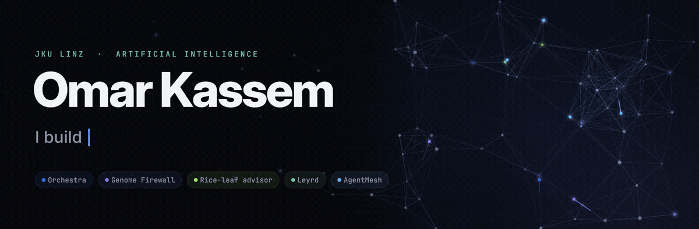
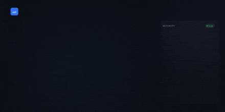
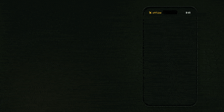
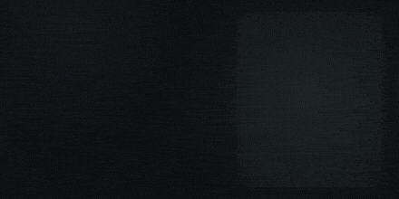
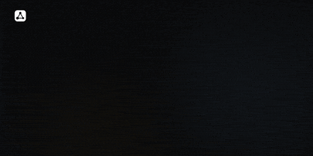

  
  
  

I study **Artificial Intelligence at Johannes Kepler University Linz** and build AI products end to end: the model, the guardrails around it, and the app people actually touch. Most of what's below started as a 24-hour hackathon and kept going after the deadline.

What I care about in an AI system: it shows its evidence, it says **"not sure"** instead of guessing, and a human makes the final call.

## Selected work

<table>
  <tr>
    <td width="50%" valign="top">
      
      <h3><a href="https://github.com/Omar-s-Org/Biohackers">Genome Firewall</a></h3>
      Upload an <i>E. coli</i> genome, get a calibrated call per antibiotic, backed by the resistance genes found, and an honest <b>no-call</b> when the evidence is thin. Trained and tested on 2,127 genomes, held out by lineage. 
      🏆 Winning project, Hack-Nation 6 (Vienna hub) · Python · scikit-learn · AMRFinderPlus · Streamlit
    </td>
    <td width="50%" valign="top">
      
      <h3><a href="https://github.com/Omar-s-Org/Orchestra">Orchestra</a></h3>
      Project management where every person works through their own AI agent. Agents pick up unlocked tasks over MCP and report what they did and what it cost; humans approve the work. 
      Hackathon prototype · TypeScript · Express · MCP · SQLite · React
    </td>
  </tr>
  <tr>
    <td width="50%" valign="top">
      
      <h3><a href="https://github.com/omarjku/BengaliPharaohs">Agronomy</a></h3>
      An offline advisor for flood-hit rice farmers in Bangladesh. A 6.1 MB on-device classifier answers only when it's confident, and otherwise says "not sure, ask your agriculture officer". In Bangla. 
      Hack-Nation 2026 · World Bank challenge · PyTorch · ONNX · FastAPI · Next.js
    </td>
    <td width="50%" valign="top">
      
      <h3><a href="https://github.com/omarjku/Leyrd">Leyrd</a></h3>
      A layer coach: how many layers to wear today, picked from your own wardrobe, using your commute forecast, 10 years of local climate and your "too cold / too warm" feedback. <a href="https://leyrd.onrender.com">Live</a>. 
      Next.js 15 · TypeScript · Postgres · Open-Meteo · Claude
    </td>
  </tr>
  <tr>
    <td width="50%" valign="top">
      
      <h3><a href="https://github.com/omarjku/pixel-perfect">AgentMesh</a></h3>
      A marketplace where AI agents compete for your task and get paid in sats over Lightning. This repo is the web app; the full project is <a href="https://github.com/px404/EnrichedUranium">px404/EnrichedUranium</a>. 
      Team project · React · TypeScript · Tailwind · shadcn/ui
    </td>
    <td width="50%" valign="top">
      
      <h3><a href="https://github.com/omarjku/Machine-Learning-Project">MyCNN</a></h3>
      A convolutional image classifier written from scratch in PyTorch: four conv blocks with BatchNorm, four augmentation pipelines, 20 classes, about 1.8M parameters. 
      Python · PyTorch · torchvision · NumPy
    </td>
  </tr>
</table>

**Also built with a team:** [Agent on a Leash](https://github.com/crii4me/viseca-agent-leash), a wallet control layer that approves, declines or asks before an AI agent spends money (Swiss {ai} Weeks 2026, 15 hours).

## Toolbox

## Off the keyboard

📷 Car photography, ideally in the rain. Same thing I like in code: patience, light, and attention to detail.

---

Every animation on this page and in my repos is code, not a screen recording: each frame is drawn on a canvas, rendered in headless Chromium and encoded with ffmpeg. The source is in [`motion/`](motion).
